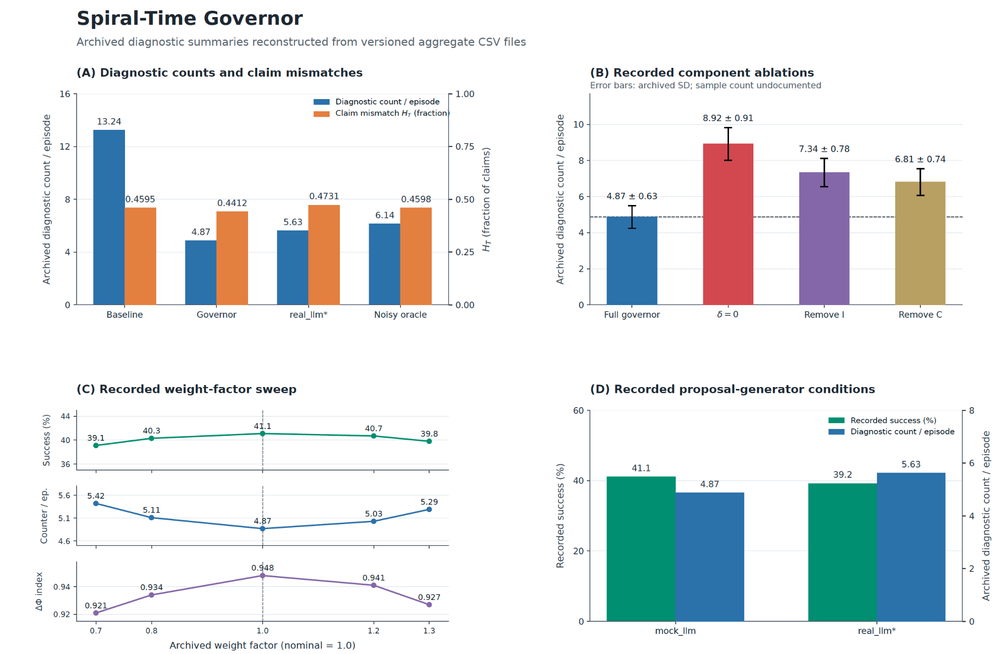

# Figure 3 archived diagnostic summaries

Figure 3 is a descriptive reconstruction of aggregate values already present in this repository. The selected image corrects the historical presentation and makes the archived numbers readable; it does not independently validate the experiments that produced them. This clarification is dated 29 October 2026.

## Proposed manuscript caption

**Figure 3. Archived diagnostic summaries for the Spiral-Time Governor.** (A) Recorded diagnostic counts per episode and claim-mismatch fractions for the source-labelled baseline, governor, real_llm, and noisy_oracle conditions. The baseline and governor H_T values in this source are 0.4595 and 0.4412; these are different from the identical 0.65 estimates in a separate historical manuscript summary. (B) Recorded component-ablation aggregates; error bars reproduce the archived standard-deviation column, with sample counts undocumented. (C) Archived weight-factor sweep, with recorded success percentage, diagnostic count per episode, and dimensionless DeltaPhi index on separate scales. (D) Recorded success percentages and diagnostic counts for the mock_llm and real_llm source labels. Original run provenance, panel-specific seed populations, and external-model run records remain unauthenticated. These descriptive aggregates do not establish independently measured physical-safety improvement, component necessity, or equivalence between proposal generators. *The asterisk on real_llm identifies a historical source-file label; the original model identity and run records have not been authenticated.*

## Sources and numerical mapping

The pinned source snapshot is [`8e66205adf0ab0ba738f4e7e1b95894745ecd501`](https://github.com/dfeen87/STG-Embodied-POC/tree/8e66205adf0ab0ba738f4e7e1b95894745ecd501). The original four-panel graphic is called Figure 8 in the repository and Figure 3 in the reviewed journal manuscript. It is distinct from `images/fig3_hallucination_rate.png`, which is a different plot.

| Panel | Preserved source | Recorded values |
| --- | --- | --- |
| A | [metrics.csv](../../results/metrics.csv) | In baseline, governor, real_llm, noisy_oracle order: diagnostic counts 13.24, 4.87, 5.63, 6.14; H_T fractions 0.4595, 0.4412, 0.4731, 0.4598. |
| B | [ablations.csv](../../results/ablations.csv) | Full governor, delta=0, remove_I, remove_C: diagnostic counts 4.87, 8.92, 7.34, 6.81; archived SD 0.63, 0.91, 0.78, 0.74. |
| C | [sensitivity_delta_phi.csv](../../results/sensitivity_delta_phi.csv) | Factors 0.70, 0.80, 1.00, 1.20, 1.30; success 39.1, 40.3, 41.1, 40.7, 39.8%; diagnostic counts 5.42, 5.11, 4.87, 5.03, 5.29; index 0.921, 0.934, 0.948, 0.941, 0.927. |
| D | [metrics.csv](../../results/metrics.csv) | mock_llm: recorded success 41.1%, diagnostic count 4.87; real_llm: recorded success 39.2%, diagnostic count 5.63. |

The three aggregate CSVs first appear in commit [`60e2348ac96f3d590e01e7689d77c4efdd96cfaf`](https://github.com/dfeen87/STG-Embodied-POC/commit/60e2348ac96f3d590e01e7689d77c4efdd96cfaf), dated 21 March 2026. The legacy `plot_figure_8` routine in [images/generate_plots.py](../../images/generate_plots.py) reads these same files. This traces the numbers through repository artifacts; it does not identify or authenticate their original experimental runs.

The selected PNG was supplied for this pull request and is included byte for byte. Its numerical labels were checked against the three CSVs. The original plot generator is preserved and does not reproduce this selected image's exact layout. File hashes and the source-to-panel mapping are recorded in [provenance.json](provenance.json).

## Evidence status

The checks completed for this update concern artifact consistency: the selected image matches the supplied PNG, the numerical labels match the aggregate files, and those files retain their pinned Git blob identities. **No experimental finding is independently verified by these checks.**

The [reviewed experiment runner](../../run_experiment.py) increments `violations` when `mode != "SAFE"` and `constraint_checker(proposed_action)` fails, while the simulator receives `gated_action`. Thus this counter is not a separately measured post-execution physical-safety endpoint. The available records do not establish that this exact implementation produced every historical aggregate.

| Historical record | Status |
| --- | --- |
| `PAPER.md`: 11.4 versus 4.7, H_T = 0.65 in both conditions | Separate manuscript summary; original run and interval provenance remain unresolved. |
| `VALIDATION_ANALYSIS.md`: 12.4 versus 5.0, seeds 0-4 | Separate historical five-seed report; not interchangeable with the manuscript or Figure 3 aggregates. |
| `results/metrics.csv`: 13.24 versus 4.87 | Descriptive aggregate values plotted here; authenticated original seed-level observations are unavailable. |
| Other hard-coded plots: 13.24 versus 12.59 | A different archived comparison; not substituted into this figure. |

The recorded differences do not justify an incremental physical-safety benefit, statistical significance of component ablations, a validated robust operating range, or equivalence between mock and external proposal generators. The success percentages and DeltaPhi index also remain historical diagnostics with unresolved measurement provenance. The differing H_T fractions in panel A must not be described as numerically unchanged or replaced with 0.65 to match another report.

## Preservation and future verification

This update adds the selected figure and clarification without changing `results/`, the original images, the original plot generator, or experiment code. Historical numerical tables remain in place. Safety, significance, necessity, robustness, and formal-guarantee wording in the repository documents and inline SVG text is qualified at the point of each claim. The original unqualified [manuscript](https://github.com/dfeen87/STG-Embodied-POC/blob/8e66205adf0ab0ba738f4e7e1b95894745ecd501/PAPER.md) and [analysis narrative](https://github.com/dfeen87/STG-Embodied-POC/blob/8e66205adf0ab0ba738f4e7e1b95894745ecd501/VALIDATION_ANALYSIS.md) remain available in the pinned source revision. Configured seed lists and a successful rerun cannot retroactively authenticate missing original records.

Independent experimental verification would require a matched protocol and implementation, identified seed populations, original per-seed observations and state/action trajectories, an independently defined physical outcome, and original external-model metadata where applicable. Any future results must be separately identified and must not be presented as recovered historical measurements.
